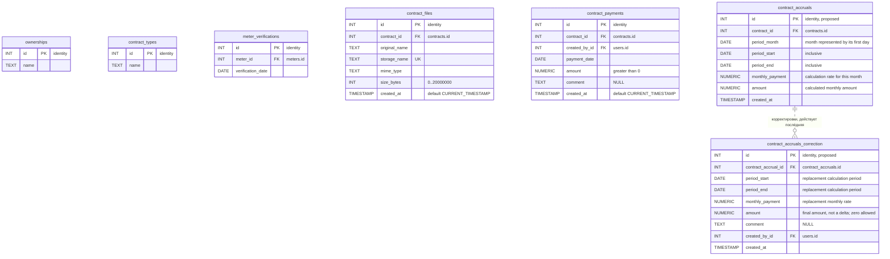

# Согласованная предметная модель Land Lord Service

Обновлено 20 ноября 2026 года по итогам интервью, вопросы 1–57 и уточнения
владельца. Прежние варианты, противоречащие этому документу, заменены последними
ответами. Концепции определяет владелец; технические поля файлов и платежей
служат хранению согласованных данных и проверке прав.

Подготовлены пять предметных миграций Doctrine на 20 таблиц:
[backend/migrations/domain/README.md](../backend/migrations/domain/README.md).
Они зарегистрированы в migrations_paths и применены к локальной development-БД
штатным Migrator после сохранения резервной копии.
Пользовательские таблицы и применённые миграции не переписывались.
Реализованы ORM всех 20 таблиц, API и экраны объектов и арендодателей.
Остальные предметные API и расчёты ещё не реализованы.

- Значения по умолчанию задаёт сервер при создании: objects.reading_day = 25,
  contracts.contract_type_id = тип «аренда». В БД оба поля NOT NULL без DEFAULT.
  Для нового объекта правило реализовано в RentalObject и RentalObjectInput;
  при разработке создания договоров применять его к ContractType.

## Состав подготовленной схемы

Все идентификаторы — INT identity. Обязательные ссылки имеют FK с ON DELETE RESTRICT.
Площади, деньги и процент — NUMERIC без заданного масштаба; миграции ничего
не округляют. Прикладной расчёт начисления округляет итог до копеек один раз в конце
по HALF_UP, без промежуточного округления дневной ставки.
Даты договора/производства/поверки/платежа — DATE. Время показания и записи —
TIMESTAMP(0) WITHOUT TIME ZONE, как в исходных черновиках. Все новые столбцы snake_case.

| Сущность | Таблица | Основные поля |
| --- | --- | --- |
| LandLord | land_lords | id, name |
| Объект | objects | id, land_lord_id, square, name, address, reading_day (сервер задаёт 25; в БД без DEFAULT) |
| Space | spaces | id, object_id, name, square |
| Ownership | ownerships | id, name; начальные записи: ЮЛ, ИП, ФЛ с полными названиями ниже |
| Renter | renters | id, ownership_id (обязательно), name, inn (NULL или уникальный непустой) |
| RenterContact | renter_contacts | id, renter_id, name; nullable last_name, patronymic, phone, email |
| ContractType | contract_types | id, name; «аренда» (по умолчанию), «юр.адрес» |
| Договор | contracts | id, space_id, renter_id, land_lord_id, contract_type_id, security_payment, expiry_date, contract_date, annulment_date?, contract_num, monthly_payment, increase_date?, increase_percent? |
| Unity | unities | id, name, use_meter, unit? |
| UnityProvider | unity_providers | id, name; unity_id? технический legacy |
| ObjectUnityProvider | object_unity_providers | id, unity_provider_id, object_id, unity_id |
| Meter | meters | id, utility_id, create_date, start_read, serial_number?, verification_date?, verification_interval_days, reading_day? |
| ObjectMeter | object_meters | id, object_id, meter_id, comment?, object_unity_provider_id? |
| SpaceMeter | space_meters | id, space_id, meter_id, comment? |
| История поверок | meter_verifications | id, meter_id, verification_date |
| MeterReading | meter_readings | id, meter_id, meter_reading_date, meter_read |
| Вложения | contract_files | id, contract_id, original_name, storage_name, mime_type, size_bytes, created_at |
| Ручной платёж | contract_payments | id, contract_id, created_by_id, payment_date, amount, comment?, created_at |
| Начисление | contract_accruals | id, contract_id, period_month, period_start, period_end, monthly_payment, amount, created_at |
| Корректировка начисления | contract_accruals_correction | id, contract_accrual_id, period_start, period_end, monthly_payment, amount, comment?, created_by_id, created_at |

У договора land_lord_id сохраняет сторону на момент заключения, а не текущего
арендодателя объекта. Смена арендодателя требует нового договора.
Space.name в будущем сервисе получает начальное значение из площади и Renter.name;
пользователь может изменить его вручную. В БД сохраняется выбранная строка.

## Дополнительные таблицы после исходных 13

По просьбе владельца в единый список включены семь дополнительных таблиц:

| Таблица | Назначение | Состояние |
| --- | --- | --- |
| ownerships | Типы арендаторов | В миграциях |
| contract_types | Типы договоров | В миграциях |
| meter_verifications | История поверок | В миграциях |
| contract_files | Метаданные вложений договоров | В миграциях |
| contract_payments | Ручные платежи по договорам | В миграциях |
| contract_accruals | Месячные начисления | В миграциях; поля согласованы |
| contract_accruals_correction | Корректировки начислений директором | В миграциях; поля согласованы |

Подготовленные миграции содержат все 20 таблиц.
Название contract_accruals_correction сохранено по запросу владельца.

Ниже первые пять таблиц соответствуют SQL. Поля двух последних — предлагаемая
структура для просмотра, не уже реализованная миграция. Владелец подтвердил:
корректировка хранит замещающие параметры и итоговую сумму, а не денежную дельту.
У одного начисления допускаются несколько корректировок. Актуальной является
последняя по порядку создания; для однозначности — created_at DESC, id DESC.
Если корректировок нет, используется исходное начисление. Корректировки не
суммируются. Значение 0 сохраняет приоритет последней корректировки (каникулы).
Повторный расчёт базы не заменяет директорскую корректировку.

Все поля обязательны, кроме помеченных NULL. INT id — генерируемый первичный ключ.
NUMERIC — точное число без ограничения масштаба хранения. TIMESTAMP в первых
пяти таблицах — TIMESTAMP(0) WITHOUT TIME ZONE. Для двух предлагаемых таблиц
предполагается тот же тип времени. Денежный результат начисления округляется
до копеек один раз в конце расчёта по HALF_UP.

## Согласованные правила

- Уточнение заказчика от 19 ноября: фиксированных помещений на объекте нет.
  `Space` выделяется из общей площади для аренды. Старую сетку комнат не реализовывать.
- Полный перечень полей, подтверждённые решения и оставшиеся вопросы находятся
  в `docs/domain-model-review.md` и `docs/requirements.md`.
- Арендодатель LandLord относится ко всему объекту. Уточнение 34–36 заменяет
  прежний расчёт свободной площади исключительно по датам действия договоров.
  Space создаётся вместе с первым договором и сразу резервирует площадь,
  включая период до начала аренды. Самостоятельного предварительного межевания нет.
  При перезаключении из-за окончания срока, смены арендатора или индексации
  сохраняется тот же Space только при отсутствии перерыва между договорами.
  Если нового договора нет, Space автоматически становится неактивным и
  освобождает резерв на следующий день после expiryDate. При расторжении —
  на следующий день после annulmentDate, сама дата включена в аренду.
  Указание будущего расторжения не освобождает площадь немедленно.
  После освобождения для новой аренды создавать новый Space, прежний не оживлять.
  square объекта — полностью сдаваемая площадь, без отдельной несдаваемой части.
  Прежнее разрешение превышения площади (ответ 36) заменено уточнением 22 ноября: отрицательный остаток запрещён.
  Пересечение периодов договоров одного Space запрещено, включая общий день
  окончания/начала. Учитывать effectiveEnd с аннулированием; следующий договор
  может начинаться со следующего дня после окончания предыдущего.
  При расчётах учитывать Space по ID; не использовать SUM(DISTINCT square):
  разные Space могут иметь одинаковую площадь.
- Отдельную таблицу/сущность резервов не создавать. Сданная площадь — сумма
  площадей Space по текущим договорам, свободная — objects.square минус сумма.
  Исторические и последующие договоры одного Space не должны удваивать площадь.
  Первый оформленный договор учитывает Space сразу, даже до начала аренды.
  Общую площадь объекта не уменьшать физически; остаток вычислять.
- Подтверждены Space.objectId, ObjectMeter.objectId и SpaceMeter.spaceId.
  Каждый Space принадлежит ровно одному объекту. Место установки прибора задаётся
  соответствующей ссылкой; одновременно допускается не более одного места,
  а у снятого прибора связи с местом установки очищены (уточнение 43).
- При изменении площади/границ, разделении или объединении создавать новые Space.
  Прежние Space и площадь по старым договорам сохранять для истории.
  Жизненный цикл Space уточнён ответом 34: создаётся с первым договором,
  сохраняется при перезаключении, становится неактивным при расторжении.
- Графический план для межевания не нужен. Пользователь вводит площадь
  и реквизиты договора. Название Space по умолчанию генерировать по площади
  и Renter.name арендатора, например «100 кв.м ИП Иванов И.И.».
  Ручное изменение названия разрешено; сохранять введённое пользователем значение.
  Использовать имя арендатора Renter, не арендодателя LandLord.
  Это последнее уточнение заменяет прежнее правило с LandLord.name.
- `contractDate` — начало аренды; дата подписания не хранится. Юрист аннулирует
  договор указанной датой (`annulmentDate`, необязательная DATE).
- Отдельного механизма продлений нет. Индексация уточнена 21 ноября: сумма
  меняется в том же договоре с сохранением полной прежней версии (см. ниже).
- Тип договора — обязательный справочник ContractType(id, name), связь
  contractTypeId (contract_type_id). Начальные записи: «аренда» (по умолчанию)
  и «юр.адрес». Оба типа связаны со Space и занимают площадь; юрадрес
  не исключать из расчёта сданной площади. Начальные записи создавать миграцией.
- У договора expiryDate обязательна; бессрочные договоры не поддерживаются.
  Индексация необязательна: increaseDate и increasePercent либо заполнены оба,
  либо оба NULL. Обеспечительный платёж обязателен как сумма, но может быть 0.
- monthlyPayment — ежемесячная сумма за весь Space, не ставка за м².
  Арендная плата и обеспечительный платёж учитываются только в рублях.
  Смена арендодателя объекта требует перезаключения договора.
- Все договоры авансовые. 5-го числа текущего месяца по действующим договорам
  неоплаченная аренда становится задолженностью; не переносить это правило
  автоматически на 6-е число.
- Ответы 58–60: директор задаёт итоговую сумму начисления за выбранный месяц,
  не дельту; допустим 0 (каникулы). В интерфейсе — скидка, каникулы или корректировка.
  Базовое начисление неполного месяца = monthlyPayment × число дней аренды
  в месяце / фактическое число дней этого месяца; конечная дата аренды включается.
  Это окончательно подтверждённое базовое правило, прежняя пометка
  о необходимости повторного согласования снята. Ответом 61 согласовано округление: один раз в конце
  расчёта до копеек,
  математическое HALF_UP (100,005 → 100,01), без округления дневной ставки.
  Директор может менять любые параметры начисления без ограничения по периоду,
  включая прошедшие и оплаченные месяцы. Сальдо пересчитывается по изменённым
  начислениям и фактическим платежам; платежи автоматически не изменять.
  Корректировка отдельного начисления не заменяет monthlyPayment в договоре.
- У одного начисления может быть несколько корректировок. Актуальные параметры
  и итоговая сумма берутся из последней корректировки этого начисления;
  если корректировок нет — из contract_accruals. Корректировки не суммируются
  и не применяются как денежные дельты. Сумма 0 является действующим значением.
  Последнюю запись выбирать по порядку создания: created_at DESC, id DESC
  для однозначности при одинаковом времени. Повторный расчёт базового начисления
  не должен заменять директорскую корректировку.
- Сальдо аренды вести по каждому договору и суммарно по арендатору.
  Импорт банковских выписок пока отложен целиком: бухгалтерия вручную вводит
  платежи в конкретный договор через интерфейс; ввод задним числом разрешён.
  Не реализовывать сейчас загрузку/разбор выписок и автоматическое сопоставление.
  Обеспечительный платёж пока только реквизит договора, без отдельного учёта
  поступлений, остатка, возврата и зачёта.
- На текущем этапе начинаем с нулевого сальдо, ввод начального долга/переплаты
  не реализовывать. Пользователь может исправлять собственную запись платежа;
  удалять платёж может только администратор. Сохранять автора создания платежа
  для серверной проверки прав. Право редактирования не означает право удаления.
- Номер договора contractNum справочный, повторения допустимы.
  К одному договору можно прикрепить несколько файлов любого типа,
  до 20 МБ каждый. Удалять вложения могут юрист и администратор.
  Исторические договоры, Space и показания физически не удалять.
  Отмена до начала аренды разрешена: договор сохраняется в истории,
  не занимает площадь и не препятствует другому договору на этот Space.
- Тип арендатора задаётся отдельным справочником Ownership(id, name).
  Связь арендатора — обязательная ownershipId (столбец ownership_id).
  Начальные записи: «Юридическое лицо», «Индивидуальный предприниматель»,
  «Физическое лицо». ИНН можно заполнить позже: отсутствие хранить как NULL,
  заполненное значение должно быть уникально среди арендаторов.
  Этот ответ 18 уточняет прежнюю обязательность ИНН для всех.
  У RenterContact обязательно только имя; фамилия, отчество, телефон и email
  необязательны. Не требовать хотя бы один канал связи.
- Приборы: целые показания, необязательный справочный `serialNumber`;
  `createDate` — вручную заполняемая дата производства и дата начального показания,
  не дата внесения в БД. Не задавать ей автоматически дату создания записи.
  У прибора не более одного места установки: объект либо Space. При снятии
  связи очищаются, прибор и показания сохраняются. Передача показаний нужна
  только при наличии установки в момент передачи. Флаг активности прибора
  не вводить; иерархии приборов нет, каждый учитывается независимо.
  verificationDate — необязательная дата последней поверки. При NULL прибор
  считается новым, базой служит createDate; иначе база — verificationDate.
  verificationIntervalDays обязателен.
  Срок = база + verificationIntervalDays календарных дней. При превышении срока
  прибор невалиден; установку разрешать с постоянным предупреждением в интерфейсе
  до действующей поверки. Статус вычислять по датам, не отдельным флагом БД.
  Единица измерения задаётся у Unity и всегда необязательна.
  Хранить только текущее место установки, без истории перемещений.
  Историю всех поверок сохранять отдельно: только связь со счётчиком и дата
  поверки (плюс технический id); комментарии, свидетельства и файлы не нужны.
  Unity.useMeter (use_meter) означает возможность установки счётчика:
  при false поля счётчика нет, при true поле доступно; наличие счётчика
  не является обязательным для каждой коммуникации с этим признаком.
  use_meter разрешено выключать при существующих счётчиках: приборы и данные
  сохраняются, связи не очищаются. Задания по показаниям зависят от установки.
- Показания одного прибора не должны уменьшаться. Ввод задним числом разрешён;
  при вставке и исправлении проверять порядок относительно предыдущего и
  следующего показания, включая начальное показание как базу.
  На пару meter_id/meter_reading_date только одно актуальное показание.
  Ошибки исправляются в существующей записи; историю значений, автора и времени
  исправления не сохранять.
- График показаний ежемесячный: общий на уровне объекта для его счётчиков и
  счётчиков Space, по умолчанию 25-е число месяца. У прибора необязательный
  собственный срок; по умолчанию наследовать график объекта, а не копировать его.
- Потребление считать разницей показаний за фактический интервал, без
  искусственной месячной разбивки при пропусках. На текущем этапе только
  потребление: тарифы, стоимость и коммунальные начисления не реализовывать.
- На объекте допускается несколько поставщиков одного типа коммуникации.
- Поставщики остаются в исходном составе полей. Площади, деньги и процент
  хранятся как NUMERIC без заданного масштаба; итог начисления округляется
  до копеек один раз по согласованному правилу, площади принудительно не округлять.
- 20 ноября владелец согласовал схему и поручил создать миграции. Пять
  предметных миграций на 20 таблиц находятся в `backend/migrations/domain`
  с namespace DomainMigrations, зарегистрированным в migrations_paths.
  20 ноября владелец поручил реализовать модели и интерфейс объектов.
  Подготовлены ORM всех 20 таблиц; объекты и арендодатели доступны через API
  и отдельные страницы Vue. Администратор и юрист создают/редактируют их,
  остальные авторизованные пользователи просматривают. Удаление не добавлено.
  Расчёты площади по договорам, начисления и остальные предметные API
  остаются последующими этапами. SQL не заменяет правила сервисов.

## Граница SQL и прикладной реализации

В SQL проверяются FK, уникальность заполненного ИНН, уникальность момента показаний,
парность полей индексации, пересечения периодов договоров одного Space,
неубывающий порядок показаний и единственность установки между двумя таблицами.
Проверки показаний и установок блокируют строку meters для сериализации операций.
Отмена до начала даёт пустой период для проверки пересечений.
[Ограничения диапазонов PostgreSQL](https://www.postgresql.org/docs/18/rangetypes.html#RANGETYPES-CONSTRAINT)
используются только для периодов договоров; отдельной таблицы резервов нет.

Жизненный цикл Space, совместное создание с первым договором, перезаключение
без перерыва и определение текущей сданной площади реализуются сервисом.
Общая objects.square не уменьшается физически. Один Space учитывается один раз
по ID; SUM(DISTINCT square) неверно, поскольку разные Space могут иметь одинаковую
площадь. Текущие SQL-черновики не добавляют ни таблицу резервов, ни сохранённый
остаток, ни флаг валидности/активности счётчика.

Чтение последней поверки/обновление meters.verification_date и записи истории
будущий сервис выполняет согласованно в одной транзакции. Предупреждение о поверке
вычисляется по последней дате или дате производства и обязательному интервалу.
График применяется только при наличии текущей установки. Перенос установки
не восстанавливается исторически: по решению владельца храним только текущую связь.

Права на исправление/удаление платежа, удаление файлов и запрет удаления
исторических договоров/Space/показаний проверяет сервер. Наличие FK не заменяет
проверку роли и автора. ORM-модели подготовлены для всей схемы. Для объектов и арендодателей реализованы
API и интерфейс; сервисы договоров, платежей и счётчиков остаются следующими этапами.
HTML-инструкция и Swagger описывают только реализованные операции.

Таблицы начислений и корректировок подготовлены в миграции. Они предусматривают итоговую сумму месяца и корректировку любых параметров директором,
в том числе в прошедших и оплаченных месяцах. Базовое начисление неполного месяца
пропорционально фактическим дням подтверждено ответом 59. Ответом 61 согласовано округление: один
раз в конце расчёта до копеек,
  математическое HALF_UP (100,005 → 100,01), без округления дневной ставки.
Наличие таблицы ручных платежей ещё не означает реализованное сальдо.

## Что согласовать перед соответствующей реализацией

- Вопросы 58–60 закрыты: итоговая сумма, пропорция неполного месяца и право
  директора изменять любые параметры, включая прошедшие и оплаченные периоды,
  подтверждены. Ответом 61 окончательно согласовано округление до копеек
  один раз в конце расчёта, HALF_UP, без округления дневной ставки.
- Денежное округление согласовано ответом 61. При реализации сохранить точность
  до финального округления; не пропускать значения через float в PHP/JavaScript.
- Поведение при дне графика 29–31, которого нет в конкретном месяце; единый часовой
  пояс и точность времени для API/календаря. Эти детали ещё не утверждены.
- Коррекция/отмена аннулирования и её влияние на уже оформленные последующие договоры.
- Матрица предметных операций и видимость по объектам/юридическим лицам до открытия
  соответствующих API. Роли пользователей сами по себе не определяют все операции.

Тарифы, коммунальные начисления, начальные остатки, импорт выписок и отдельный
учёт обеспечительного платежа сейчас вне объёма. Потребление — разница между
показаниями за фактический интервал; пропущенные месяцы не интерполируются.
Сроки реализации не назначены. Штатный запуск миграций остаётся без черновиков.

## Организация предметных сервисов

Каждая сущность управляется собственным <Entity>Service. LandLordService
отвечает за арендодателей, RentalObjectService — за объекты. Проверка
незавершённых договоров для смены арендодателя вынесена в ContractService.
Контроллеры используют сервис своей сущности; общего CRUD-сервиса с выбором
типа записи нет. Пустые сервисы для последующих модулей не создаются.

Цвет арендодателя: добавочная миграция Version20261120140000 вводит
land_lords.color VARCHAR(7) NULL (#RRGGBB), с CHECK формата. NULL означает
цвет отображения Indigo; значение по умолчанию определяется интерфейсом.
Общий контракт Colorable и trait HasColor можно подключать к другим сущностям
с отдельной миграцией их таблицы. Общей таблицы без внешних ключей не создаём.

Реализация договоров/Space от 21 ноября описана в docs/implementation-plan.md.
Новых изменений схемы для этого блока не потребовалось: использованы ранее согласованные таблицы.
Полиморфное хранение цветов остаётся согласованной отдельной задачей.

## Версии и действия с договорами: уточнение от 21 ноября

- Текущее физическое состояние находится в основной таблице с valid_from.
  <table>_history зеркалит все её столбцы и добавляет valid_to. Архив содержит
  только прежние версии; при создании архив пуст. При фактическом изменении
  архивирование и запись нового состояния происходят в одной транзакции.
  Сохранение без изменений не создаёт версию.
- Границы [valid_from, valid_to). valid_from новой версии всегда равен времени
  физического сохранения, включая индексацию. Запланированных изменений нет.
  Дата индексации не переносит изменение суммы в будущее или прошлое.
- Для старых записей неизвестная дата создания остаётся NULL, без выдумывания
  даты. UI показывает «Дата неизвестна». Новые записи получают время UTC.
- Общий механизм версий подключён к LandLord, RentalObject, Renter, Space,
  Contract. Новые столбцы сущности добавлять миграцией одновременно в основную
  таблицу и её _history. Не копировать текущую запись в архив.
- В карточке договора: «Основное» и «История изменений». Первая запись
  отображается как «Создание договора», без отдельной архивной записи.
- «Действия с договором»: «Изменение» (арендатор, окончание, месячный платёж),
  «Расторжение» (дата аннулирования), «Индексация». Только юрист/администратор.
  Изменения действуют сразу и сохраняют прежнее полное состояние.
- Индексация меняет сумму того же договора, сохраняя реквизиты и Space.
  Это уточнение заменяет прежнее правило нового договора при индексации.
  Процент и новая сумма взаимно вычисляются; последнее изменённое поле
  определяет расчёт. Деньги — HALF_UP до копеек, обратный процент до 6 знаков.
- Периодичность выключена по умолчанию. При включении нужен положительный
  интервал месяцев от даты индексации; это только напоминания в календаре,
  без автоматического изменения платежа. В коротком месяце день ограничен
  последним числом, следующая дата снова рассчитывается от исходного дня.

Последнее уточнение поставщиков: общий справочник, произвольное число коммуникаций;
на каждом объекте свой набор связей поставщик/коммуникация, поставщики могут
пересекаться между объектами. Общий счётчик может необязательно выбрать такую
связь своего объекта и типа. Детали сохранения прежних версий — docs/meters.md.

## Уточнение договоров поставщиков от 22 ноября

Владелец подтвердил отдельные договоры объекта с коммунальным поставщиком: номер, дата и обязательный срок «Действует до». Один договор может охватывать несколько коммуникаций. У одной пары объект/поставщик бывает несколько договоров, старые сохраняются. Сущность UnityProviderContract и миграции реализованы; существующая связь object_unity_providers не заменяет договор.

## Реализация договоров поставщиков и типов уведомлений: 22 ноября

UnityProviderContract хранится в unity_provider_contracts: id, object_id, unity_provider_id, contract_num?, contract_date?, expiry_date, is_suspended, valid_from, unity_ids? (снимок состава коммуникаций для версий). Текущие связи коммуникаций — unity_provider_contract_unities; прежние реквизиты — зеркальная unity_provider_contracts_history с valid_to. Неизвестный состав старых версий остаётся NULL, не восстанавливается догадкой. Несколько договоров на объект/поставщика допустимы; удаления API не предоставляет.

notification_types: id INT, name TEXT, days INT, roles JSONB, is_active BOOLEAN. Заполняется миграцией известными системными типами, параметризует все три генератора (аренда/индексация, показания, поставщики). Прежний статус «договоры поставщиков ещё не реализованы» заменён этим разделом.

## Изменение помещения неподписанного договора: согласовано 22 ноября

- До подписания юрист и администратор могут менять объект и площадь помещения через основную форму договора. После подписания объект и площадь неизменны.
- Свободная площадь после сохранения не может быть отрицательной. Это уточнение заменяет прежнее разрешение превышения площади из ответа 36. Нулевой остаток допустим; NUMERIC сравнивается точно, без округления.
- При изменении резерв пересчитывается без двойного учёта текущего договора. При переносе освобождается площадь исходного объекта и резервируется на новом; арендодатель черновика определяется новым объектом.
- Если Space связан только с этим черновиком, корректируются его текущие объект и площадь. Если Space используется другими договорами, для изменяемого черновика выделяется новый Space; прежние договоры сохраняют прежнюю площадь и объект. Пересечения и разрывы оставшейся цепочки запрещены, как ранее согласовано.
- Недостаток площади отклоняет всю операцию: договор, Space, резерв и история остаются прежними. Объекты блокируются в порядке ID, проверки и изменения выполняются в одной транзакции. Уменьшение общей площади объекта ниже занятой также запрещено.
- Новое чтение GET /api/objects/{id}/availability?contractId=... используется формой для точной предварительной проверки и не кэшируется в сеансе. Исключается резерв договора, а не весь Space, который могут резервировать другие договоры. Окончательная проверка выполняется сервером при сохранении.
- Изменения неподписанного договора по-прежнему не архивируются. Правила версий Space и сохранения исторических записей не отменены.
